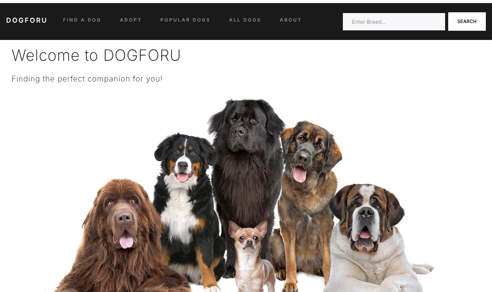

# DogForU

**Find the right dog for your lifestyle, learn about the breed, and see adoption organizations near you.**

DogForU is a Flask web app covering 263 dog breeds. You can pick the temperament and purpose you're looking for and get matching breeds, search any breed to see its traits and similar dogs, and find nearby shelters through the Petfinder API.



## Features

- **Dog Finder.** Choose temperament traits (Loyal, Playful, Intelligent...) and what the dog is bred for (Companion, Guarding, Hunting...). DogForU lists every breed that matches all of your choices.
- **Breed pages.** Each breed has its temperament, what it was bred for, its life span, and a list of similar breeds.
- **Search.** The navbar search on every page finds a breed by exact name (case-insensitive) or by partial match, so "terrier" lists all 37 terriers.
- **Adopt.** Detects your city from your IP address and lists adoption organizations within 100 miles, using the Petfinder API (US and Canada).
- **Browse.** Popular dogs and a full gallery of all 263 breeds.

## Tech stack

| Layer | Tools |
|---|---|
| Backend | Python, Flask |
| Frontend | Jinja2 templates, HTML, CSS, Bootstrap |
| APIs | [Petfinder API](https://www.petfinder.com/developers/) via `petpy`, [ipinfo.io](https://ipinfo.io) geolocation |
| Data | Breed dataset stored as JSON (`data/breeds.json`) |

## Running it locally

**Requirements:** Python 3.10+

```bash
git clone https://github.com/SreeramNara/DogForU.git
cd DogForU

python -m venv venv
source venv/bin/activate        # Windows: venv\Scripts\activate
pip install -r requirements.txt

cp .env.example .env            # then add your API keys to .env
python flask_app.py
```

Then open http://127.0.0.1:5000.

### API keys

Add these to `.env`. It's listed in `.gitignore`, so keys never get committed.

| Variable | Required for | Get one |
|---|---|---|
| `PETFINDER_KEY`, `PETFINDER_SECRET` | Adopt page | Free at [petfinder.com/developers](https://www.petfinder.com/developers/) |
| `IPINFO_TOKEN` | Adopt page (optional) | Free at [ipinfo.io/signup](https://ipinfo.io/signup) |

Everything except the Adopt page works without any keys. Without Petfinder keys, the Adopt page shows a "no information available" message instead of crashing.

## Project structure

```
DogForU/
├── flask_app.py          # Flask routes, breed search and matching logic
├── data/
│   ├── breeds.json       # 263 breeds: temperament, bred for, life span, image
│   ├── popular_dogs.json # Breeds shown on the Popular Dogs page
│   └── region_codes.json # Province/state name -> code, for Petfinder location search
├── templates/            # Jinja2 HTML pages
├── static/
│   ├── styles.css
│   ├── bootstrap.min.css
│   └── breeds/           # Locally hosted breed photos
├── requirements.txt
└── .env.example          # Template for API keys
```

## How the matching works

- **Dog Finder** keeps a breed only if it has *every* temperament trait you checked and was bred for *every* purpose you checked.
- **Similar breeds** on a breed page are breeds that share at least one temperament trait. When you search a multi-word breed name, it shows breeds that share a word in their name instead (for example, other Collies).

## Deploying

The app was originally deployed on AWS. To deploy it anywhere that runs Python web apps, point your host's WSGI server at `flask_app:app`, for example:

```bash
pip install gunicorn
gunicorn flask_app:app --bind 0.0.0.0:8000
```

Set the same environment variables from `.env.example` in your host's settings.
